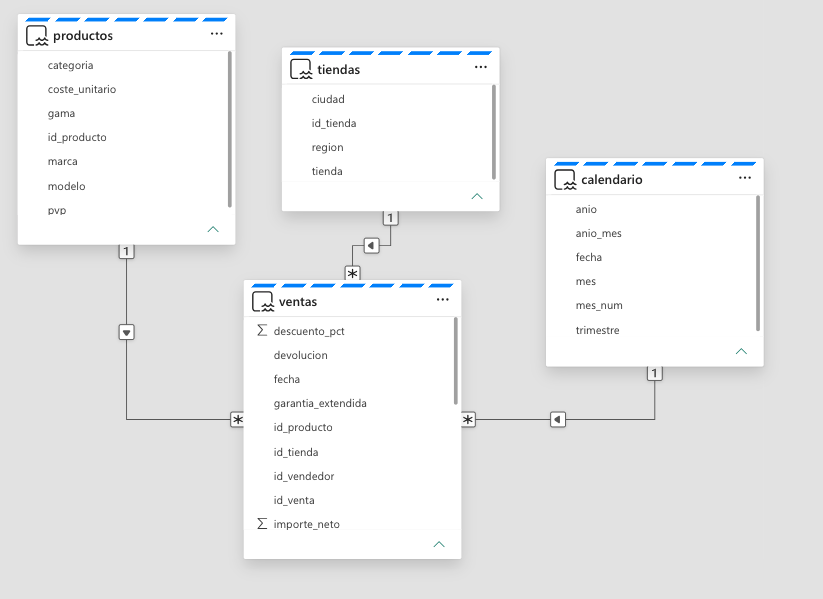
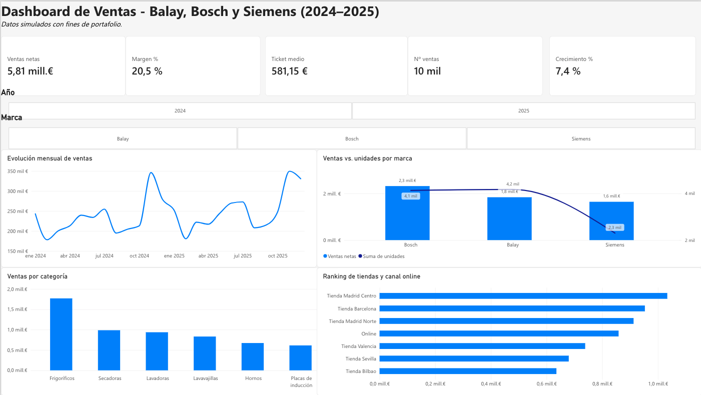
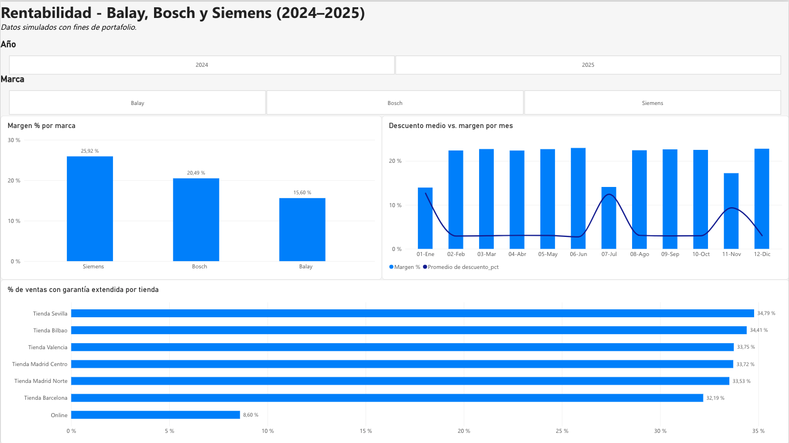

# 📊 Dashboard de Ventas · Balay, Bosch y Siemens (2024–2025)

Análisis comercial y de rentabilidad de **10.000 ventas simuladas** de electrodomésticos, construido con **Power BI** sobre **Microsoft Fabric**.

> ⚠️ Los datos son **simulados** con fines de portafolio y no corresponden a ninguna empresa real.

---

## 🎯 Objetivo

Responder a tres preguntas de negocio que me encuentro a diario como vendedor de electrodomésticos, pero ahora desde los datos:

1. ¿La marca que más vende es también la más rentable?
2. ¿Cuánto margen cuestan las campañas como Black Friday o las rebajas?
3. ¿Qué diferencia hay entre la tienda física y el canal online?

## 🛠️ Herramientas

- **Python** (pandas, NumPy): generación del dataset
- **Microsoft Fabric**: Lakehouse para almacenar las tablas
- **Power BI**: modelo semántico (Direct Lake), medidas DAX y dashboard

## 🧱 Arquitectura

```
CSV  →  Lakehouse (Fabric)  →  Modelo semántico Direct Lake  →  Dashboard Power BI
```

### Modelo en estrella



| Tabla | Tipo | Contenido |
|---|---|---|
| `ventas` | Hechos | 10.000 ventas: fecha, tienda, producto, unidades, descuento, importe, garantía, devolución |
| `productos` | Dimensión | 54 modelos · 3 marcas · 6 categorías · 3 gamas · PVP y coste |
| `tiendas` | Dimensión | 6 tiendas físicas + canal online |
| `calendario` | Dimensión | Fechas de 2024 y 2025 con año, mes y trimestre |

## 📐 Medidas DAX

Las 11 medidas del modelo están explicadas en [medidas_dax.md](medidas_dax.md). Las principales:

```DAX
Ventas netas = SUM(ventas[importe_neto])
Coste total  = SUMX(ventas, ventas[unidades] * RELATED(productos[coste_unitario]))
Margen %     = DIVIDE([Margen €], [Ventas netas])
Crecimiento % = DIVIDE([Ventas 2025] - [Ventas 2024], [Ventas 2024])
```

## 📈 Dashboard

### Página 1 · Resumen comercial


### Página 2 · Rentabilidad


## 💡 Conclusiones

**1. Vender más no es ganar más.**
Balay es la marca que más unidades vende, pero la que menos margen deja (**15,6 %**). Siemens vende casi la mitad de unidades y es la más rentable (**25,9 %**).

**2. Las campañas tienen un precio.**
En los meses normales el margen ronda el **23 %** con un descuento medio del **3 %**. En Black Friday y rebajas, el descuento sube al **12 %** y el margen cae a entre un **14 y un 17 %**.

**3. El vendedor marca la diferencia.**
En tienda física, más del **32 %** de las ventas incluye garantía extendida. En el canal online, solo el **8,6 %**, unas 4 veces menos. El asesoramiento en tienda genera ingresos que el canal online no captura.

**Resumen:** 5,81 M€ de ventas · 20,5 % de margen · 581 € de ticket medio · +7,4 % de crecimiento interanual.

## 📁 Estructura del repositorio

```
├── data/
│   ├── ventas.csv
│   ├── productos.csv
│   ├── tiendas.csv
│   └── calendario.csv
├── img/                    # Capturas del dashboard y del modelo
├── Dashboard_Ventas_BSH.pdf
├── generar_dataset.py      # Script que genera los datos
├── medidas_dax.md
└── README.md
```

## ▶️ Cómo reproducirlo

```bash
pip install pandas numpy
python generar_dataset.py
```

Después, carga los 4 CSV de `data/` en Power BI (o en un Lakehouse de Fabric), relaciona `ventas` con las tres dimensiones y crea las medidas de `medidas_dax.md`.

## 🔗 Enlaces

- **Caso de estudio en Notion:** [Ver documentación](https://massive-partner-85f.notion.site/4090b8a57e608191bd83f223a080298d)
- **LinkedIn:** [Claudio Abreu Afonso](https://www.linkedin.com/in/claudioabreuafonso/)
- **Otros proyectos:** [github.com/Ca2105](https://github.com/Ca2105)

---

**Autor:** Claudio Abreu Afonso · Data Analyst Jr.
